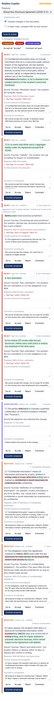

# RedliningPal

**Your companion for contract negotiations.** redliningPal tracks every version the counterparty sends, compares it with the right version of yours, checks each change against your negotiation playbook, and lets you approve, reject or counter it directly in Word.

The counterparty can send their changes as **tracked changes**, or as a **clean copy**. For a clean copy, the add-in compares it with your last version. Each change goes to an LLM with the playbook, and the answer passes through a deterministic harness. You then work through the findings in the task pane: **accept**, **reject**, **comment**, or **counter-propose**. Counter-proposals are written into the document as *your* tracked changes, touching only the words that differ.

There is also a **Google Docs add-on** with the version panel, the base version and the untracked-change cards. Google Docs gives scripts no way to accept, reject or create suggestions, so there the add-on warns and the lawyer acts. See [Google Docs add-on](#google-docs-add-on).



## Why it is built this way

| Concern | Design choice |
|---|---|
| The LLM may skip a change, invent a rule, or soften a red line | `validateFindings()` gives every change exactly one finding, with missing ones set to `human_review`. It drops unknown rule ids and duplicates, and keyword guardrails from the playbook can only **escalate** a verdict, never relax it. Every intervention is listed under "Harness notes". |
| Structured output | A forced tool call (`report_findings`) checked against a JSON schema. No free-text parsing. |
| API key safety | The key stays on the local server (`server.js`). The browser only calls `/api/review`. |
| Audit | The server logs one line per review: model, playbook version, verdict counts and harness interventions. Contract text is never logged. |
| Demo without a key | Mock reviewer (keyword heuristics) runs automatically when `ANTHROPIC_API_KEY` is not set. |
| Testability | All logic is in pure modules under `public/lib/`: the OOXML tracked-change parser, paragraph diff, guardrails and validator. They are tested in Node against generated sample contracts. |

## Project layout

```
manifest.xml                 Office add-in manifest (adds a button on the Review tab)
server.js                    Starts the HTTPS server, the optional Google Docs API port and the Gmail poller
server/app.js                Routes: task pane, review proxy, intake API, version timeline, triage
server/intake.js             Email -> matter -> version -> base -> integrity check -> review
server/timeline.js           Which version is open in Word; base / supersedes / newer around it
server/routing.js            Matter assignment by stamp, thread, subject tag, sender, text
server/matching.js           Text fingerprints: base detection, renditions
server/intent.js             "corrected version" / "for signature" detection (DE/EN/PL)
server/store.js              Version registry (JSON + content-addressed files)
server/gmail-poller.js       Reads a Gmail label over IMAP
server/docx.js               Paragraph extraction and rc-ver stamp
scripts/stamp.js | intake.js Stamp an outgoing draft | feed .eml files and print the timeline
config/intake.example.json   Our addresses, matters, counterparties, routing thresholds
playbooks/spa-share-deal.json Buyer-side SPA playbook (12 rules)
samples/spa/                 SPA scenario: v1 ours, v2 markup, v2.1 "corrected", clean copy
tests/fixtures/emails/       7 email scenarios (.eml)
public/taskpane.html|css|js  Task pane UI + Office.js actions
public/lib/ooxml.js          Rebuilds before/after text from <w:ins>/<w:del>
public/lib/diff.js           Paragraph alignment (clean-copy mode), word diff, minimal edit
public/lib/review.js         Prompt, tool schema, guardrails, validator, mock reviewer
public/lib/version-view.js   Version panel, "accept all" gate, untracked changes as cards
playbooks/mutual-nda.json    Sample playbook: 9 rules with preferred / fallback / never
samples/                     Sample NDA: our v1, counterparty v2 tracked, v2 clean
gdocs/                       Google Docs add-on (Apps Script): Code.gs, Sidebar.html, appsscript.json,
                             VersionView.html (generated from public/lib/version-view.js)
scripts/build-gdocs.js       Generates gdocs/VersionView.html (npm run gdocs:build)
docs/gdocs-manual-test.md    Manual test checklist for the Google Docs add-on
tests/                       Unit tests + Office.js stub for browser preview
tests/fixtures/gdocs/        A real Google Docs export of the synthetic SPA v2
```

## Setup, step by step

Remaining steps: **1 Install → 2 Certificates → 3 API key → 4 Start → 5 Sideload → 6 Try it**

### 1. Install
Requires Node 18+.
```bash
cd redlining-pal
npm install
npm test            # 114 tests should pass
```

### 2. Trust a localhost certificate
Office only loads add-ins over HTTPS.
```bash
npm run certs
```
Accept the OS prompt to trust the dev CA. You only need to do this once per machine.

### 3. (Optional) Add your Claude API key
Skip this step to use the mock reviewer.
```bash
export ANTHROPIC_API_KEY=sk-ant-...         # Windows PowerShell: $env:ANTHROPIC_API_KEY="sk-ant-..."
export REDLINE_MODEL=claude-sonnet-5-5      # optional, this is the default
```

### 4. Start the server
```bash
npm start
```
You should see `redliningPal on https://localhost:3000`. Open that URL plus `/taskpane.html` in your browser once to confirm the certificate is trusted.

### 5. Sideload the add-in into Word
- **Word on the web:** open a document → **Home → Add-ins → More add-ins → My add-ins → Upload My Add-in** → choose `manifest.xml`.
- **Word desktop (Windows/Mac):** run `npx office-addin-debugging start manifest.xml desktop`, or put `manifest.xml` in a shared-folder catalog.

A **redliningPal → Review redlines** button appears on the **Review** tab.

### 6. Try it with the samples
1. Open `samples/nda_v2_counterparty_tracked.docx` in Word.
2. Click **Review redlines**, keep "Tracked changes in this document", then click **Scan & review**.
3. Expected results: the residuals clause, the non-solicit and the EUR 10k liability cap come back as red-line rejects (flagged by guardrails). Term, return and governing law come back as negotiate.
4. Click **Counter-propose** on the Term finding. The counterparty's change is rejected, and your counter-proposal is inserted as your own tracked change.

To test clean-copy mode, open `samples/nda_v2_counterparty_clean.docx`, choose "A clean copy", and pick `samples/nda_v1_ours.docx` as the baseline.

### Browser preview (no Word needed)
```bash
PREVIEW=1 HTTP_ONLY=1 npm start
# open http://localhost:3000/preview.html
```
This runs the real task pane against a sample docx, with a stub in place of Office.js. It's useful for UI work and screenshots.

## Email intake and version tracking

In a negotiation the danger is not reading the redline. It is reading it against the **wrong version**. Typical problems:
- the counterparty edited an older draft
- a "corrected" version arrives the next morning
- a clean copy comes in a new thread
- somebody changes a clause with track changes switched off

Intake handles this from the mailbox.

```
email ─► attachments (.docx only; PDF/.doc/.docm flagged)
      ─► matter      stamp +100 · thread +60 · [TAG] in subject +60 · sender +20/30 · text match up to +50
                     auto if ≥ 60 and 25 ahead of the runner-up, otherwise -> triage queue
      ─► version     ours / theirs · base = OUR version they worked on (text-verified, stamp is a hint)
                     same base + we haven't replied yet -> supersedes their previous version (v2 -> v2.1)
                     identical text to a known version -> filed as a rendition, no new review
      ─► analysis    tracked changes vs base · INTEGRITY: "reject all" of their file must equal our base
                     findings reused for changes carried over from a superseded version
      ─► notify      "v2.1 (base v1, replaces v2), 13 changes, 1 UNTRACKED, 4 reject, 3 new since v2"
```

The **version graph** stores `base` and `supersedes` as two separate links. A corrected version has the same base as the version it replaces, and it is compared with that base, not with the faulty version it replaces. The delta against the replaced version only tells the lawyer what is new.

The **stamp** is a custom document property `rc-ver` holding a random UUID. It contains no names, because the counterparty can see document properties. Word keeps it when the other side edits the file. The base is still chosen by matching the text, so a stamp copied into the wrong round can't mislead the system.

### Try it without Gmail
```bash
npm run intake -- tests/fixtures/emails/*.eml
```
This prints the timeline: v1 ours, v2 superseded by v2.1 with **1 untracked change** (the fraud carve-out in 4.4 was deleted with tracking off), the clean copy filed as a rendition, and the unknown NDA in triage. Delete `data/` to start over.

### Version panel in Word
When the task pane opens, it asks the server which registered version the open document is. It shows:
- the matter and version ("v2.1 · counterparty"), and whether the text matches the registered file exactly or only probably (for example after some changes were already accepted)
- the **base** (with an **Open base version** button) and what the version **supersedes**
- a warning if a newer version exists, so nobody reviews an outdated draft
- a **"changes without track changes"** badge. Those changes appear as review cards, and **Accept all** stays blocked until the lawyer ticks "I have reviewed…". The acknowledgement is stored and audited.

The document is identified by its **text**, not its stamp: the counterparty edits our stamped file, so their versions still carry our stamp. A clean copy starts the review in compare mode against the base from the registry, so no file picker is needed.

If the document is not registered anywhere, the pane offers **File for a matter decision**. The lawyer picks the matter, whose version it is and its base (the best text match is suggested), then confirms. Nothing is registered before that click. If the pane is closed first, the item waits in `/api/triage`.

To see it without Word, load the fixtures into a scratch registry and open the preview on v2.1:
```bash
export REDLINE_DATA=/tmp/redline-demo
npm run intake -- tests/fixtures/emails/*.eml
PREVIEW=1 HTTP_ONLY=1 npm start
# open http://localhost:3000/preview.html?doc=spa/spa_v2-1_theirs_corrected.docx
```

### Gmail demo, step by step

Use synthetic documents only (the samples in `samples/spa/`), never real client contracts.

Remaining steps: **1 App password → 2 Label + filter → 3 Config → 4 Start → 5 Send the scenario → 6 Check**

1. **App password.** Turn on 2-step verification for your Google account, then create an app password at <https://myaccount.google.com/apppasswords>. In Gmail settings, under *Forwarding and POP/IMAP*, check that IMAP is enabled.
2. **Label and filter.** Your intake address is your own address plus a tag: `yourname+redline@gmail.com`. In Gmail, create the filter `to:(yourname+redline@gmail.com)` → *Apply label* `redline-intake`. Under *Settings → Labels*, check that "Show in IMAP" is ticked for that label.
3. **Config.** Copy `config/intake.example.json` to `config/intake.json` and change these fields:
   - `ourAddresses`: `["yourname@gmail.com"]`
   - `intakeAddresses`: `["yourname+redline@gmail.com"]`
   - in matter `SPA-Nordlicht`, `counterpartyAddresses`: your second address (it plays the Seller's counsel)
4. **Start.**
   ```bash
   export GMAIL_USER=yourname@gmail.com
   export GMAIL_APP_PASSWORD="xxxx xxxx xxxx xxxx"
   export GMAIL_POLL_SECONDS=30
   npm start
   ```
   The log should show `[gmail] polling label "redline-intake"`.
5. **Send the scenario.** Each mail goes to the other party with `yourname+redline@gmail.com` in CC:
   1. From your address to the Seller address: subject `[SPA-Nordlicht] Share Purchase Agreement`, attach `samples/spa/spa_v1_ours.docx`. It is already stamped. For your own drafts, run `npm run stamp -- draft.docx` first.
   2. From the Seller address, *Reply all*: attach `spa_v2_theirs_tracked.docx`.
   3. From the Seller address, *Reply all* again: "Please disregard our draft of yesterday, the attached version replaces it." Attach `spa_v2-1_theirs_corrected.docx`.
6. **Check.** The server log shows a `[notify]` line for each version. To see the full picture, open `https://localhost:3000/api/matters/SPA-Nordlicht`, or run `npm run intake` with no files to print the timeline.

If your own CC copy does not appear under the label, Gmail has hidden a copy addressed to yourself. Forward the sent mail to `yourname+redline@gmail.com`; intake recognises forwards of your own mails as outbound.

### API
| Method | Path | Purpose |
|---|---|---|
| POST | `/api/intake` | Raw email (RFC 822) as body. This is the hook for n8n or Power Automate later. |
| GET | `/api/matters`, `/api/matters/:id` | Matters and their version graph with analyses |
| GET | `/api/versions/:id/file` | Download the stored .docx of a version |
| GET | `/api/versions/:id/timeline` | Base, supersedes / superseded by, newer version, untracked count. Ids and labels only, no contract text. |
| GET | `/api/versions/:id/untracked` | Changes made without track changes, as review cards |
| POST | `/api/versions/:id/ack-untracked` | Record that a lawyer reviewed them (unblocks bulk accept; audited) |
| POST | `/api/documents/identify` | `{ afterTexts, beforeTexts, stamp }` of the open document → exact / probable / unknown + timeline |
| POST | `/api/versions/:id/findings` | The current .docx as body → the version's playbook findings, each with its state in that document (open / countered / accepted / rejected / changed). Audit: counts only. |
| POST | `/api/documents/identify-file` | The whole .docx as body (Google Docs add-on) → same answer, plus `opened: { hasTrackedChanges, stamped }` |
| POST | `/api/documents/triage` | Unknown .docx as body → triage item (409 if already registered) |
| GET | `/api/triage` | Mails and documents that could not be assigned automatically |
| GET | `/api/triage/:id/bases?matterId=&side=` | Suggested bases for a document triage item |
| POST | `/api/triage/:id/assign` | Mail: `{ "matterId" }`, re-processes the mail. Document: `{ "matterId", "side": "ours" \| "theirs", "baseId"? }`, registers it. |

With `GDOCS_PORT` and `REDLINE_API_TOKEN` set, the server starts a second listener on `127.0.0.1:<GDOCS_PORT>` for the Google Docs add-on. It serves the API only (no task pane, samples or playbooks) and answers 401 unless the request carries `Authorization: Bearer <token>`. It refuses to start with a token shorter than 32 characters. The Word port is unchanged and needs no token.

## Google Docs add-on

The counterparty's .docx often ends up in Google Drive. The add-on brings the version timeline there: the lawyer opens the file in Google Docs and sees which version it is, its base and whether anything was changed without track changes.

### What it does, compared with Word

| | Word task pane | Google Docs sidebar |
|---|---|---|
| Matter, version, base, supersedes, "newer version" warning | ✅ | ✅ same logic (`version-view.js`, built into `gdocs/VersionView.html`) |
| Open base version | new Word window | Google Doc copy in your Drive, opened from a link; reused on the next click |
| Changes without track changes | cards; **Accept all is blocked** until acknowledged | cards with **Go to** and a **suggested edit** of only the words that differ ("Insert “or fraud” after “…in case of intent”"): **Mark the spot** puts the cursor there (or selects the text to replace or delete), **Copy** copies just those words. A red **advisory** warning until acknowledged. Accept all in Google Docs cannot be blocked. |
| Accept / reject / counter-propose | written as tracked changes | not possible from a script; the lawyer pastes the copied words (or presses Delete) in **Suggesting mode**, which makes it a normal, minimal suggestion |
| Unknown document | triage, confirmed by the lawyer | same flow |
| Playbook review of each tracked change | ✅ live review of the open document | ✅ the findings stored at intake, one card per suggestion in clause order, verdict as a badge (reject cards marked red): verdict, rules, reasoning, their change as a word diff, and what to do: accept (✓), reject (✗), or reject and then suggest our counter-proposal as a minimal edit; **Copy comment** for the counterparty. Each card shows its **state** in the Doc as it is now: open, our counter-proposal is in, accepted, rejected, or changed. Handled cards are hidden until "Show handled changes". **Go to** also works while their suggestion is still open: it falls back to the words their change did not touch. |

How it identifies the open Doc: Apps Script exports it as .docx (exactly like *File → Download → Microsoft Word*) and sends the file to `/api/documents/identify-file`. We checked by hand that a Google Docs export keeps every tracked change as a suggestion and back, the paragraph texts, and our `rc-ver` stamp (Google hides the stamp in *File → Details* but writes it back on export). So the server needs no Google-specific parsing.

### Setup, step by step

Remaining steps: **1 Server → 2 Tunnel → 3 Apps Script project → 4 Push → 5 Test deployment → 6 Settings**

1. **Server with a token.** Google's servers cannot reach `localhost`, so the add-on talks to a second, token-protected port that a tunnel exposes.
   ```bash
   export REDLINE_DATA=~/redline-gdocs-demo           # optional: keep data/ clean
   npm run intake -- tests/fixtures/emails/*.eml      # demo matter SPA-Nordlicht
   export REDLINE_API_TOKEN=$(node -e 'console.log(require("crypto").randomBytes(24).toString("base64url"))')
   echo $REDLINE_API_TOKEN                            # you need it in step 6
   HTTP_ONLY=1 GDOCS_PORT=3001 npm start
   ```
2. **Tunnel** (second terminal). cloudflared is a single binary; no apt, no account:
   ```bash
   mkdir -p ~/.local/bin && curl -L -o ~/.local/bin/cloudflared https://github.com/cloudflare/cloudflared/releases/latest/download/cloudflared-linux-amd64 && chmod +x ~/.local/bin/cloudflared
   ~/.local/bin/cloudflared tunnel --url http://127.0.0.1:3001
   ```
   Copy the `https://….trycloudflare.com` address. It changes every time the tunnel starts. Check it: `curl <address>/api/matters` must answer 401.
3. **Apps Script project.** At [script.google.com](https://script.google.com) create a new project `redliningPal`. Turn on *Google Apps Script API* at [script.google.com/home/usersettings](https://script.google.com/home/usersettings).
4. **Push the code** with clasp (a dev dependency):
   ```bash
   npx clasp login --no-localhost       # sign in; the browser then shows "localhost refused to connect":
                                        # copy that page's full URL into the terminal (never share it)
   npx clasp list                       # shows the script id of redliningPal
   cp gdocs/.clasp.json.example gdocs/.clasp.json   # once; put the script id in (git-ignored)
   npm run gdocs:push                   # builds VersionView.html, pushes the 4 add-on files
   ```
   Without clasp, paste `Code.gs`, `Sidebar.html`, `VersionView.html` and `appsscript.json` into the editor (*+ → HTML* for the two HTML files; *Project Settings → Show appsscript.json*).
5. **Test deployment, once per Doc.** Upload a sample .docx to Drive and convert it (*File → Save as Google Docs*). In the script editor: *Deploy → Test deployments → Editor Add-on → Create new test*, version *Latest code*, config *Installed and enabled*, pick the Doc, *Execute*. Google warns that the app is unverified: it is your own script, so *Advanced → Go to redliningPal*.
6. **Settings.** In the Doc: *Extensions → redliningPal → Open version panel → Settings*: tunnel address and token. They are stored in your Google user properties for this script, never in the Doc or the repo, and the token never reaches the sidebar.

Try it with the converted `samples/spa/spa_v2-1_theirs_corrected.docx`: v2.1, base v1, supersedes v2, and one card for clause 4.4, where "or fraud" was deleted without track changes. The full checklist is in [docs/gdocs-manual-test.md](docs/gdocs-manual-test.md).

### Permissions, and why

| Scope | Why |
|---|---|
| `documents.currentonly` | read the open Doc's id and name, sidebar, go to a passage |
| `drive.readonly` | export the open Doc as .docx. `drive.file` alone gets HTTP 403 for a Doc the add-on did not create. |
| `drive.file` | create the "Open base version" copy (Advanced Drive service v3, converts .docx to a Google Doc) |
| `script.external_request` | call the tunnel |
| `script.container.ui` | show the sidebar |

The export uses the Docs export link (`docs.google.com/document/d/<id>/export?format=docx`), not the Drive REST API: the REST call needs the Drive API enabled in the script's hidden Cloud project and fails with 403 otherwise.

### Data flow and privacy

```
Google Doc ─► Apps Script (Google) ─► cloudflared (Cloudflare) ─► 127.0.0.1:3001 on your machine
```
The whole document passes through Google's Apps Script runtime and the tunnel provider. That is fine for the synthetic samples; it is **not** a setup for client documents. Quick tunnels have no uptime guarantee and are subject to Cloudflare's terms. The server's audit lines for the add-on (`identify_file`, `ack_untracked`, `triage_assign`) carry ids, scores and counts, never contract text. Stop the tunnel (Ctrl+C) when you are done.

### Troubleshooting

| Message in the sidebar | Fix |
|---|---|
| Not set up yet | Settings: tunnel address and token |
| The server rejected the token | Token in Settings ≠ `REDLINE_API_TOKEN` of the running server |
| Server not reachable… | Server or tunnel stopped, or the tunnel address changed: update Settings |
| The server sent no JSON | The address is not the token port (for example the Word port, or a tunnel to the wrong port) |
| Google refused to export this document (HTTP 403…) | `appsscript.json` lacks `drive.readonly`; push it and approve the new permission |
| Could not create the Google Doc copy | In the script editor, *Services + → Drive API*, then try again |
| Menu entry appears twice | An old copy of the script is bound to the Doc (*Extensions → Apps Script*); delete it |

### Why not "Extensions → Add-ons → Get add-ons"?

That menu lists add-ons published in the Google Workspace Marketplace. Publishing publicly means Google's review, and `drive.readonly` is a restricted scope with an additional security assessment. Publishing privately to an organisation needs a Google Workspace account. For a demo, test deployments are enough. A **Google Workspace add-on** (card UI instead of an HTML sidebar) could be installed once and appear in every Doc without publishing; see the ideas below.

## Writing your own playbook
Add a JSON file to `playbooks/`. Each rule has these fields:
```json
{
  "id": "NDA-04", "topic": "Residuals clause",
  "preferred": "...", "fallback": null, "never": "...", "guidance": "...",
  "keywords": ["residual"],                  // mock reviewer matching
  "redFlags": ["residual", "unaided memory"], // newly added phrase => escalate
  "redFlagVerdict": "reject"                  // floor: negotiate | human_review | reject
}
```

## Requirements and known limits
- **WordApi 1.6** is needed to accept or reject tracked changes. That means Word on the web or current Microsoft 365 desktop. On older builds, clean-copy mode and comments still work.
- Changes are grouped **per paragraph**. Accept and reject apply to all tracked changes in that paragraph.
- Text boxes, footnotes, headers and footers are not scanned.
- If a counter-proposal can't be placed as a minimal edit, the add-in replaces the whole paragraph text. Character formatting inside that paragraph is then lost.
- Clean-copy alignment is heuristic (LCS on paragraphs plus word similarity). Heavily restructured documents may pair the wrong paragraphs.
- Findings are suggestions. The playbook and a lawyer decide.

Intake limits:
- The registry is a JSON file for a single user. The store interface is where Postgres, SharePoint or a DMS (iManage, NetDocuments) would plug in.
- Intent detection is rule-based (DE/EN/PL).
- A version is treated as "replacing" another only when it has the same base and we have not replied yet. If the email does not say it is a correction, the version is flagged for confirmation.
- The open document is matched by paragraph text. A "probable" match needs 60% of its paragraphs to come from one version. Heavily rewritten drafts, or two matters on the same template, may need the lawyer to confirm. Close matches are flagged.
- The untracked-changes acknowledgement records when, not who: the prototype has no user accounts.

Google Docs limits:
- Scripts cannot accept, reject or create suggestions (Google Docs API), so the "accept all" gate is a warning, and counter-proposals are pasted by the lawyer in Suggesting mode. The add-on never edits the document itself: its edits would be changes without track changes.
- The suggested edit covers one contiguous change per paragraph. Several separate changes in one paragraph, or more than 200 characters, fall back to copying the whole wording.
- The add-on runs as a test deployment, one per Doc (see above).
- It needs a tunnel and a running local server; the quick tunnel address changes on every restart.
- Comments can be added by the lawyer as usual; the add-on does not create them ("Copy comment" prepares the text).
- The playbook review shows the findings made when the version arrived (intake). It does not review again what the lawyer changes in the Doc; the state per change is recomputed on every refresh.
- The state is matched per paragraph by text. A paragraph whose text occurs twice, or a change split across paragraphs, may show as "changed".

## Next steps (ideas)
- "Reopened" flag: the counterparty changes a clause that was agreed in an earlier round
- LLM intent classification behind the rules (output limited to the same enum)
- n8n or Power Automate flow posting to `/api/intake`, as an alternative to the poller
- Eval set: a labelled redline corpus to score verdict accuracy per rule (see the clause-harness approach)
- Export a negotiation log (change, verdict, action taken) as .xlsx for the matter file
- Per-rule fallback ladders (first, second, final position) across negotiation rounds
- Run the model on Azure/Bedrock in an EU region for client-data compliance
- Word: use `suggestionEdit` for counter-proposals too ("intent." → "intent or fraud." is currently written as a replaced word, not an insertion)
- Google Docs: rebuild the sidebar as a Google Workspace add-on (card UI), installable once for all Docs without Marketplace publishing
- A named Cloudflare tunnel or a hosted server (e.g. Cloud Run) instead of the quick tunnel
